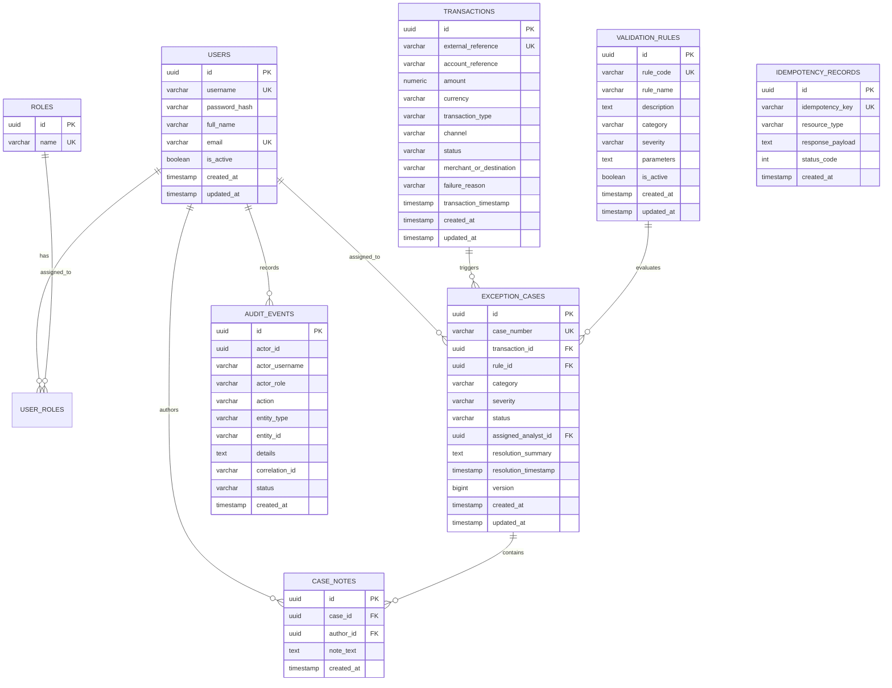

# BankOps — Banking Operations & Exception Management Platform

[](https://github.com/bankops/bankops-core/actions)


BankOps is an enterprise-grade internal banking operations dashboard and workflow platform designed for financial institutions. It enables operations personnel and risk analysts to monitor synthetic transaction streams, detect operational anomalies, triage exceptions through a structured state-machine workflow, and maintain an immutable, append-only audit trail with correlation tracing.

> **Operational Context**: BankOps operates exclusively with synthetic transaction data and fictional customer accounts. It does not connect to live payment rails (SWIFT, Fedwire, ACH) or real financial entities.

---

## 1. System Architecture

```mermaid
flowchart TD
    subgraph Client ["Frontend (React 18 + TypeScript + Vite + Tailwind)"]
        UI[Enterprise Operations Console]
        AuthStore[Secure Auth & Session Context]
        APIClient[Axios Client with Correlation Interceptors]
    end

    subgraph Security ["Spring Security 6 & Filters"]
        CORS[CORS Policy Filter]
        CID[X-Correlation-ID MDC Filter]
        JWT[Stateless JWT Auth Filter]
        RBAC[Method Security @PreAuthorize]
    end

    subgraph CoreServices ["BankOps Modular Services Layer"]
        TxService[Transaction Service & CSV Ingestion Engine]
        RuleEngine[Configurable Operational Rules Engine]
        CaseService[Exception Workflow State Machine]
        AuditService[Append-Only Audit Trail Publisher]
        DashService[Real-Time KPI Analytics Aggregator]
        AdminService[User & Rule Administration Service]
    end

    subgraph Storage ["PostgreSQL 16 & Flyway"]
        Flyway[Flyway Migrations (V1 Schema, V2 Seed)]
        DB[(PostgreSQL Relational DB)]
    end

    UI --> APIClient
    APIClient --> CID --> CORS --> JWT --> RBAC
    RBAC --> TxService & CaseService & DashService & AdminService
    TxService --> RuleEngine --> CaseService
    TxService & CaseService & AdminService --> AuditService
    TxService & CaseService & AuditService & DashService --> DB
```

---

## 2. Entity-Relationship (ER) Diagram



---

## 3. Technology Stack

### Backend
- **Language**: Java 17 / 21 LTS
- **Framework**: Spring Boot 3.2.4
- **Security**: Spring Security 6 with stateless HMAC-SHA256 JWT (`jjwt 0.12.5`)
- **Data & ORM**: Spring Data JPA, Hibernate ORM 6 with `@Version` optimistic concurrency control
- **Database Migrations**: Flyway Core (`V1__init_schema.sql`, `V2__seed_demo_data.sql`)
- **Database Engine**: PostgreSQL 16 (production/docker) & H2 in-memory (isolated unit testing)
- **CSV Ingestion**: Apache Commons CSV
- **API Documentation**: SpringDoc OpenAPI 3 / Swagger UI
- **Testing**: JUnit 5, Mockito 5, AssertJ, Spring Test MockMvc

### Frontend
- **Framework**: React 18, TypeScript, Vite
- **Styling**: Tailwind CSS with enterprise dark slate theme
- **Visualization**: Recharts (Volume & Exception Area Chart, Category Distribution Pie Chart, Severity Profile Bar Chart)
- **Icons**: Lucide React
- **HTTP Client**: Axios with distributed correlation ID (`X-Correlation-ID`) interceptor

### DevOps & Infrastructure
- **Containerization**: Docker multi-stage builds & Docker Compose
- **Continuous Integration**: GitHub Actions (`.github/workflows/ci.yml`)

---

## 4. Key Features

### Feature A: Transaction Monitoring & Ingestion
- Server-side pagination, sorting, and multi-field filtering (status, date range, channel, transaction type, amount).
- Streaming batch CSV ingestion with row-level error validation.
- Idempotency control: Replays of identical `X-Idempotency-Key` return cached results and prevent duplicate database writes.

### Feature B: Exception & Case Management Workflow
- Automated operational exception case creation upon rule violation.
- Strict state-machine lifecycle: `OPEN` $\rightarrow$ `IN_REVIEW` $\rightarrow$ `RESOLVED`.
- Reopening a resolved case is strictly protected: permitted **only** by users with `ROLE_ADMIN` and requires a mandatory justification audit note.
- Optimistic concurrency control via `@Version` prevents lost updates during concurrent triage.

### Feature C: Immutable Audit Trail
- Append-only event store capturing logins, CSV batch imports, case status transitions, analyst assignments, and rule modifications.
- Distributed correlation ID (`X-Correlation-ID`) propagation from HTTP headers into Slf4j MDC.

### Feature D: Operations Control Dashboard
- Real metrics aggregated from persisted application records:
  - Total, Successful, and Failed Transaction Volume.
  - Exception Rate formula: $\text{Exception Rate \%} = \left(\frac{\text{Total Cases}}{\text{Total Transactions}}\right) \times 100$
  - Mean Resolution Time formula: $\text{Avg Resolution Time} = \frac{\sum (\text{resolved\_at} - \text{created\_at})}{\text{Count of Resolved Cases}}$
  - Real-time Recharts visual trends over configurable 7, 14, or 30-day windows.

---

## 5. Getting Started & Local Setup

### Prerequisites
- Java 17 or Java 21 JDK
- Apache Maven 3.9+
- Node.js v18+ and npm
- Docker Desktop (optional, for full containerized execution)

### Option 1: Running with Docker Compose (Recommended)
```bash
# Clone or navigate to the repository root
cd bankops

# Copy environment template
cp .env.example .env

# Build and start PostgreSQL, Backend, and Frontend containers
docker-compose up --build
```
- Frontend UI: `http://localhost:3000`
- Backend REST API: `http://localhost:8080`
- Swagger UI Documentation: `http://localhost:8080/swagger-ui.html`

### Option 2: Running Locally (Terminal)

#### 1. Start Backend
```bash
cd backend
mvn clean spring-boot:run
```
*(The backend will start on port 8080 with Flyway migrations executing automatically).*

#### 2. Start Frontend
```bash
cd frontend
npm install
npm run dev
```
*(The Vite development server will start on `http://localhost:5173`).*

---

## 6. Demo Accounts (Synthetic Local Seed)

| Username | Password | Role | Permissions |
| :--- | :--- | :--- | :--- |
| `admin` | `Password123!` | `ROLE_ADMIN` | Full access: rule configuration, user admin, case reopen, all metrics |
| `analyst_david` | `Password123!` | `ROLE_ANALYST` | Case investigation, assignment, status update, transaction query |
| `analyst_maria` | `Password123!` | `ROLE_ANALYST` | Case investigation, notes logging, status update |

---

## 7. Sample API Requests

### 1. Authenticate & Obtain JWT
```bash
curl -X POST http://localhost:8080/api/v1/auth/login \
  -H "Content-Type: application/json" \
  -d '{"username": "admin", "password": "Password123!"}'
```

### 2. Search Filtered Transactions
```bash
curl -X GET "http://localhost:8080/api/v1/transactions?status=FAILED&page=0&size=10" \
  -H "Authorization: Bearer <YOUR_JWT_TOKEN>" \
  -H "X-Correlation-ID: CORR-DEMO-001"
```

### 3. Transition Case Status (with Optimistic Locking)
```bash
curl -X PATCH http://localhost:8080/api/v1/exceptions/e0000000-0000-0000-0000-000000000002/status \
  -H "Authorization: Bearer <YOUR_JWT_TOKEN>" \
  -H "Content-Type: application/json" \
  -d '{
    "targetStatus": "RESOLVED",
    "resolutionSummary": "Verified routing clearinghouse timeout. Operational risk sign-off obtained.",
    "expectedVersion": 0
  }'
```

### 4. Ingest Synthetic CSV Batch (with Idempotency Key)
```bash
curl -X POST http://localhost:8080/api/v1/transactions/import \
  -H "Authorization: Bearer <YOUR_JWT_TOKEN>" \
  -H "X-Idempotency-Key: BATCH-IMPORT-KEY-001" \
  -F "file=@data/samples/sample_transactions.csv"
```

---

## 8. Automated Test Execution & Verification

To run the automated unit and workflow test suite:
```bash
cd backend
mvn test -Dtest="*Test,!*IntegrationTest"
```

**Verified Test Execution Results**:
```text
[INFO] Running com.bankops.modules.dashboard.DashboardServiceTest
[INFO] Tests run: 1, Failures: 0, Errors: 0, Skipped: 0
[INFO] Running com.bankops.modules.exceptioncase.ExceptionCaseWorkflowTest
[INFO] Tests run: 6, Failures: 0, Errors: 0, Skipped: 0
[INFO] Running com.bankops.modules.rule.RuleEngineTest
[INFO] Tests run: 5, Failures: 0, Errors: 0, Skipped: 0
[INFO] Running com.bankops.modules.transaction.TransactionCsvParserTest
[INFO] Tests run: 2, Failures: 0, Errors: 0, Skipped: 0
[INFO] Running com.bankops.security.JwtTokenProviderTest
[INFO] Tests run: 2, Failures: 0, Errors: 0, Skipped: 0
[INFO] 
[INFO] Results:
[INFO] Tests run: 16, Failures: 0, Errors: 0, Skipped: 0
[INFO] BUILD SUCCESS
```

---

## 9. Security Design & Limitations

1. **Authentication**: Stateless HMAC-SHA256 JWT tokens. Password hashes generated via standard BCrypt with cost factor 10.
2. **Audit Immutability**: Application-level security restricts audit trail APIs strictly to append operations. However, this does not defend against superusers with direct database administrative privileges.
3. **Threshold Rules**: Configurable rule matches represent operational triggers for triage workflows, not conclusive evidence of financial fraud or money laundering.
